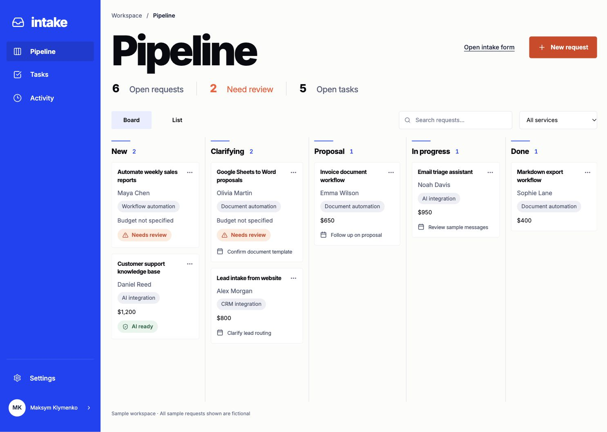
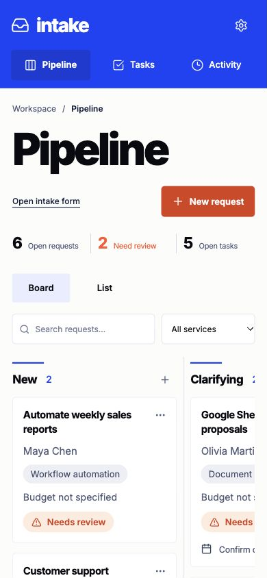

# Intake — AI client-intake CRM

A portfolio MVP for a solo automation consultant: turn an unstructured client message into a reviewable brief, a deal and the next action.

**Client request → contact and deal → OpenAI extraction → validation → follow-up tasks → activity history.**



## What works

- Public intake form and an owner workspace with a five-stage board, list view, search and service filters.
- Original messages saved before analysis. OpenAI prepares a structured summary, requirements, explicit budget/deadline, missing-information checklist, tasks and a reply draft.
- Idempotent event processing: a repeated submission does not create duplicate requests; a reused key with different content returns HTTP 409. Different requests from one email share a client.
- Stage changes, tasks and analysis outcomes recorded in an activity history.
- Manual review and copyable reply drafts. The app does not automatically send email or approve commercial terms.
- Separate local demo and Supabase-backed storage, with owner-only access enforced by RLS and transactional RPCs.
- Server-side API credentials, bounded AI requests, cached ready results and one persistent spending meter shared across instances.

This portfolio MVP uses fictional sample requests.

## Stack

Next.js 16 App Router · React 19 · TypeScript · OpenAI Responses API with Structured Outputs · Zod · Supabase Postgres/Auth · native CSS · Lucide icons.

## Try the demo

Use Node.js 22.9+ or a newer supported LTS release.

```sh
npm ci
npm run dev:demo
```

Open **http://127.0.0.1:3100**. The demo seeds seven fictional requests and explicitly disables paid AI traffic, even if the parent shell has an API key. No service account is required. Local JSON storage is for a single development process.

## Connect your own services

1. Copy `.env.example` to `.env.local`. Never commit that file.
2. Create your own Supabase project and apply both SQL files in `supabase/migrations/` in timestamp order.
3. For cloud CRM storage, set the two `NEXT_PUBLIC_SUPABASE_*` settings, `CRM_OWNER_EMAIL` and `CRM_APP_URL`. Enable email sign-in and allow the application's `/auth/confirm` callback in Supabase Auth.
4. Before enabling OpenAI, provision your own shared spending meter. Create a random 256-bit server-only capability, save its SHA256 digest in `crm_private.ai_budgets.token_hash`, and configure `CRM_AI_METER_URL`, `CRM_AI_METER_PUBLISHABLE_KEY` and `CRM_AI_METER_TOKEN`. Set `CRM_AI_BUDGET_USD` to your chosen total allowance in dollars, within the schema limits, and use the corresponding microdollar value in the meter row. The meter may use the same Supabase project. Only the digest belongs in the database; the raw capability stays in server configuration.
5. Set your own `OPENAI_API_KEY` and enable `CRM_ENABLE_OPENAI`. The repository includes no working keys, hosted database instance or existing meter capability.

An administrator can initialize a new meter row using their own digest:

```sql
insert into crm_private.ai_budgets (id, token_hash, limit_micros)
values ('portfolio-demo', '<sha256-of-your-own-capability>', <allowance-in-microdollars>);
```

Replace the placeholders with your 64-character digest and an integer allowance in microdollars within the schema limits. Existing meter reservations are persistent.

```sh
npm run dev:local  # local sample storage + your OpenAI connection, port 3100
npm run dev        # Supabase storage + owner sign-in, port 3101
```

Run only one process per port. Local launchers bind to loopback; hosted deployment needs separately configured server secrets and a platform-appropriate Next.js start command.

## Reliability and AI boundaries

- The client message is untrusted data. The model cannot execute tools, change identity, send mail, approve prices or move deal stages.
- Strict output shape and semantic checks reject invalid amounts/dates. Unknown fields stay unknown. Failed analysis preserves the original request.
- Analysis claims prevent concurrent duplicate paid calls; ready results are cached. Claims expire after 90 seconds. Retries are explicit, with five attempts per request and thirty starts per workspace/day.
- Calls use `gpt-5-mini`, a 45-second timeout, no automatic SDK retry, at most 3,000 output tokens and `store: false`.
- Pricing and model assumptions were checked on 26 October 2026; review them before operating a fork with different pricing or models.
- Public intake can only queue a request. Owner authentication is required to prepare an AI brief in the cloud workspace.

See [architecture and trust boundaries](docs/architecture.md).

## Verification

```sh
npm run typecheck
npm test
npm run build
node scripts/smoke.mjs http://127.0.0.1:3100  # no-key demo mode only
```

The 24 automated tests cover idempotency, conflicting payloads, client deduplication, failed/stale analysis, task/stage transitions, persistence, semantic validation and spending guards. The build and all tests passed for the published version. SQL checks in `tests/cloud-verification.sql` and `tests/shared-budget-verification.sql` exercise owner isolation, RPC boundaries, transactions and the shared meter; their fixtures roll back.

`npx tsx scripts/verify-openai.ts` is an **optional paid** check using synthetic inputs and your own configured key. Use `--one` for one case. Ordinary tests and the demo do not call OpenAI.

See [verification notes](docs/verification.md).

## Interface

Cobalt navigation, large display typography, open board lanes and compact metadata keep the next action visible. The mobile layout uses top navigation and a separately scrolling board; drawers and forms adapt to the viewport.



## Current scope

Gmail/n8n ingestion, attachment parsing, multi-person assignment and automated outbound email are future extensions. A hosted public demo is not included in this repository.
