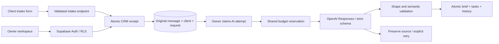

# Architecture and invariants

## Data

`crm_workspaces` owns `crm_clients`, `crm_requests`, `crm_tasks`, and `crm_events`. Composite foreign keys keep client/request/task relationships inside one workspace. A workspace belongs to `auth.users.id`, not user-editable metadata.

## Access

All exposed tables have RLS. `anon` has no table privileges. Authenticated users can select only records belonging to their own workspace; they can insert only a workspace owned by their own auth ID. CRM mutations are narrow transactional RPCs that verify `auth.uid()` against the workspace owner before changing data. They lock the workspace row to serialize idempotency, rate-limit and state checks.

The one anonymous mutation, `submit_crm_intake`, intentionally uses a capability token. It resolves the unpredictable workspace token, validates bounded input, limits intake to 20 new events/hour, and creates a contact/request/task/event transaction. It returns only whether the submission was already received. It exposes no client data and cannot run AI. Private helpers are in an unexposed schema with execute revoked from API roles.

The Supabase advisor reports the intentionally callable SECURITY DEFINER RPCs. These are not blanket grants: anonymous access is granted only to insert-only public intake; all owner RPCs explicitly verify ownership. See [the public-function advisor](https://supabase.com/docs/guides/database/database-linter?lint=0028_anon_security_definer_function_executable) and [authenticated-function advisor](https://supabase.com/docs/guides/database/database-linter?lint=0029_authenticated_security_definer_function_executable). Cloud verification tests their authorization boundaries rather than suppressing these notices.

## AI trust boundary

Messages are untrusted data. The model does not execute tools, send email, set identity, approve prices or change deal stages. It returns a constrained brief that is checked before commit. Unknown budgets and dates stay null; ambiguous deadline text is preserved. Human review remains explicit in the UI. Keys stay server-side, and the OpenAI client is pinned to the official API origin to avoid inheriting an unrelated proxy URL.

## Failure and concurrency

Receipt completes before analysis. An analysis claim prevents duplicate paid calls; ready results are cached. An expired processing lock is retryable in both UI and database. A failed analysis cannot erase the original message. The provider error shown to the client is sanitized. The development adapter uses a per-file queue plus atomic rename; it is deliberately separate from the production adapter.

## Shared spending control

A persistent Postgres meter reserves a conservative amount before each model call. Row locking serializes concurrent reservations across app instances. Failed or uncertain calls retain their reservation; actual known usage is recorded separately. If the meter is unavailable or its configured allowance is exhausted, no model call starts.

Meter RPCs require a server-only capability; the database stores only its SHA256 digest. That capability grants no CRM data access and cannot call OpenAI. Private meter tables deny direct API access through RLS and revoked grants. The SQL verification suite covers incorrect capabilities, denied direct reads, reservation bounds and idempotent receipts.

The reservation policy assumes a bounded text request and a fixed output-token maximum for the configured model. Recheck provider pricing before changing that policy or using another model.
